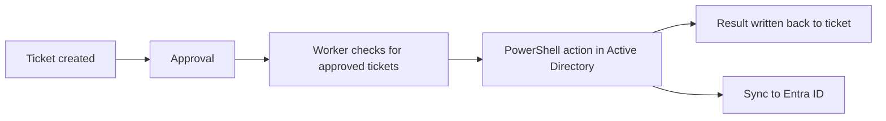

# Hybrid Identity Lifecycle Automation

A home lab for learning how a help desk manages user identities across the full lifecycle (joiner, mover, leaver) in Active Directory and Microsoft Entra ID, with the goal of automating those changes from ITIL-style support tickets.

> **Status: early stage.** The on-premises Active Directory foundation is built and working. The ticketing workflow, lifecycle scripts, Entra ID sync, and automation are **planned, not built yet**. See the status table below for what exists today.

## Goals

- Build an Active Directory environment that works like a small company's (domain controller, domain-joined client, user accounts, Group Policy).
- Handle common help desk requests (new user, password reset, lockout) the way a support team would, following ITIL-style ticket types.
- Automate user onboarding, role changes, and offboarding with PowerShell.
- Extend the lab to a hybrid setup by syncing a limited set of users to Microsoft Entra ID.
- Document everything, including problems hit along the way.

## Status

| Component | Status |
|---|---|
| Windows Server promoted to domain controller, domain created | Done |
| Windows 11 client joined to the domain | Done |
| User accounts created with PowerShell (about 5 test users) | Done |
| User administration and password resets | Done |
| Group Policy: minimum password length and account lockout timer | Done |
| OUs and role-based security groups | Planned |
| Ticketing tool with ITIL-style ticket types | Planned |
| PowerShell joiner and leaver scripts with logging | Planned |
| Mover (role change) workflow | Planned |
| Entra ID sync, scoped to a lab OU, with MFA | Planned |
| Ticket-driven automation worker | Planned |
| Knowledge base articles for common issues | Planned |

## Lab environment

| Item | Details |
|---|---|
| Domain controller | Windows Server `[version]` with AD DS and DNS |
| Client | Windows 11, built from an ISO and joined to the domain |
| Virtualization | `[VMware / VirtualBox]` |
| Domain name | `[lab domain, for example lab.local]` |
| Tools used | Server Manager, Active Directory Users and Computers (ADUC), DNS Manager, PowerShell |

All accounts are test accounts with fake data. No real user information is stored in this repository.

## What is built so far

1. **Domain controller.** Promoted a Windows Server to a domain controller and created the domain.
2. **Domain join.** Joined a Windows 11 client to the domain and signed in with a domain account.
3. **User creation.** Created about 5 user accounts with PowerShell and administered them, including password resets.
4. **Group Policy.** Applied a policy setting a minimum password length and an account lockout timer.

## Planned design

The goal is for an approved ticket to trigger the matching identity change without anyone running a script by hand. Because the domain controller sits inside the lab, the planned design has a small worker inside the lab that checks the ticketing tool for approved tickets and makes the change, so nothing in the lab needs to be exposed to the internet.



**Planned ticket types**

| Ticket | ITIL category | Action |
|---|---|---|
| New hire | Service request | Create the user and add role groups |
| Access request | Service request | Add the user to a group after approval |
| Role change | Service request | Add new access and remove the old |
| Offboarding | Service request | Disable the account, remove groups, move to a Disabled OU |
| Password reset or lockout | Incident | Reset the password or unlock the account |

**Planned safeguards**

- Act only on approved tickets, and never let a requester approve their own ticket.
- Restrict the automation to the lab OU so it cannot touch other accounts.
- Run it under a limited service account, not a domain administrator.
- Include a dry-run mode that logs what would change.
- Log every action and write the result back to the ticket.
- Keep credentials out of the repository.

## Repository layout

```
.
├── README.md
├── docs/            # lab notes, diagrams, troubleshooting write-ups
├── scripts/         # PowerShell scripts (planned)
└── kb-articles/     # short how-to articles for common issues (planned)
```

Folders will be added as the work is completed.

## Skills practiced

Active Directory, Windows Server, Group Policy, PowerShell, DNS, user and password administration, help desk workflows, and technical documentation.

## Notes

- This is a learning lab, not a production system.
- Entra ID features that need a paid license are out of scope unless a trial is available.
- Do not commit passwords, tenant IDs, real email addresses, or screenshots that show account details.

## Author

Zaheen Rahman · [GitHub](https://github.com/zaheenqrahman)
