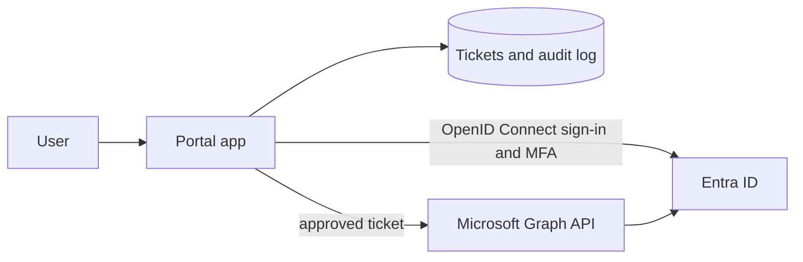

# Network-Aware Zero-Trust Automated IAM Platform/System

A single application platform hosted on Azure with testing and deployement pipelines used to streamline vendor specific uses like ticketing, IAM with authentication features reducing user fatigue and increasing ease of access built with a front end platform that is easy to navigate. The back end will be secured using network security protocols = API's with tools.

> **Status: building stage.** This repository is at the planning stage. 

## The problem

Many organizations split identity and support across separate vendors: one product for sign-in and access (for example an identity provider such as Okta), another complete seperate vendor platform that has to make users log in again to request a ticket that can increase fatigue especially when there is little to no help when something breaks. An agent is also available directly to talk to on the original sign in and access platform page to get to the app's resources sucessfully for the user's ease of access.

 An application built on Microsoft Entra ID, using its sign-in, MFA, groups, and Microsoft Graph API to deliver an Okta-like experience (central sign-in, role-based access, lifecycle changes) together with ticketing. It runs against a test tenant with fake users. It is a project to introduce a solution to fix a problem that should be more streamlined for users to access.

## Planned features

**Identity and access**
- Single sign-on with Entra ID using OpenID Connect (MSAL)
- MFA through Entra ID for test users
- Role-based access in the app: Requester, Helpdesk, Admin
- Group-based access to the application
- Audit log of sign-ins and actions

**Ticketing (built into the same app)**
- Ticket types: new hire, access request, role change, offboarding, password reset
- SLA, ticket's notes, documentation bases
- Approval step before any identity change is made

**User lifecycle (joiner, mover, leaver)**
- Approved tickets trigger changes through Microsoft Graph: create a user and add groups, change group membership, or disable an account
- Results are written back to the ticket

**Safeguards**
- A requester cannot approve their own ticket
- Automation is limited to a designated test group of users
- Least-privilege Graph permissions
- Dry-run mode that logs what would change
- Secrets are kept out of the repository

## Planned architecture diagram for how the front end may interact with the back end. 

## Planned tech stack (SDK)

| Layer | Choice |
|---|---|
| App | Python and FASTApi (maybe Okta Node/Python SDKs within it) |
| Authentication | Entra ID with MSAL (OpenID Connect) |
| Identity actions | Microsoft Graph API |
| Storage | SQLite for tickets and the audit log |
| Hosting | Runs locally first; Azure hosting is optional later |
| Front End | React and TypeScript for platform user interface from an Azure-hosted app
| Agent/Agentic Flow|  Anthropic API, Build a MCP, LangGraph, Pydantic

## Status

The plan for the first steps before I begin to create the back end: 
| Test users and groups in the Entra ID tenant | Planned |
| App registration and single sign-on | Planned |
| App roles (Requester, Helpdesk, Admin) enforced in the app | Planned |
| Ticket creation, listing, and status changes | Planned |
| Approval workflow, with self-approval blocked | Planned |
| Graph actions triggered by approved tickets | Planned |
| Audit log | Planned |
| Documentation, diagram, and demo | Planned |

## The scope

- Features that need paid Entra ID licenses (such as Conditional Access) are out of scope unless a trial is available.
- Sign-in and audit logs on the free tier are kept for a short time, so screenshots and exports are captured as the work progresses.

## Author

Zaheen Rahman · [GitHub](https://github.com/zaheenqrahman)
