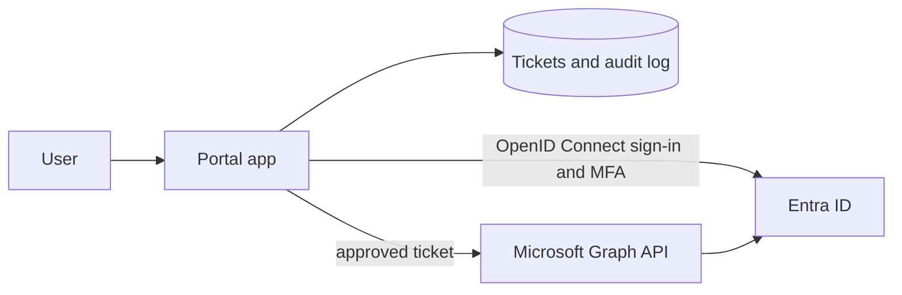

# Unified Identity Lifecycle Platform and System Automated

A single application that provides Okta-style identity features (single sign-on, multi-factor authentication, role-based access, and user lifecycle management) on top of Microsoft Entra ID, with a help desk ticketing system built into the same product.

> **Status: building stage.** This repository is at the planning stage. The design and milestones below describe what is planned, not what is built. The status table is updated as each piece is completed.

## The problem

Many organizations split identity and support across separate vendors: one product for sign-in and access (for example an identity provider such as Okta), and another for tickets (for example a separate help desk platform). An access request, a password reset, or a new hire then involves a ticket in one system and a manual change in another, with no single record of who requested what, who approved it, and what changed. Learning a front-end framework.

This project explores a streamlined alternative: identity and ticketing in one application, where an approved ticket drives the identity change and every step is logged in one place.

## What this is, and is not

- **It is** an application built on Microsoft Entra ID, using its sign-in, MFA, groups, and Microsoft Graph API to deliver an Okta-like experience (central sign-in, role-based access, lifecycle changes) together with ticketing.
- **It is not** a re-implementation of Okta. Entra ID is the identity provider. The project's own work is the application layer on top: roles, approvals, ticket-driven lifecycle actions, and audit logging.
- It runs against a test tenant with fake users. It is a learning project, not a production system.

## Planned features

**Identity and access**
- Single sign-on with Entra ID using OpenID Connect (MSAL)
- MFA through Entra ID for test users
- Role-based access in the app: Requester, Helpdesk, Admin
- Group-based access to the application
- Audit log of sign-ins and actions

**Ticketing (built into the same app)**
- Ticket types: new hire, access request, role change, offboarding, password reset
- ITIL-style classification (incident or service request), priority, status, and closure notes
- Approval step before any identity change is made

**User lifecycle (joiner, mover, leaver)**
- Approved tickets trigger changes through Microsoft Graph: create a user and add groups, change group membership, or disable an account
- Results are written back to the ticket

**Safeguards**
- A requester cannot approve their own ticket
- Automation is limited to a designated test group of users
- Least-privilege Graph permissions
- Dry-run mode that logs what would change
- Secrets are kept out of the repository

## Planned architecture

## Planned tech stack

| Layer | Choice |
|---|---|
| App | Python and FASTApi |
| Authentication | Entra ID with MSAL (OpenID Connect) |
| Identity actions | Microsoft Graph API |
| Storage | SQLite for tickets and the audit log |
| Hosting | Runs locally first; Azure hosting is optional later |
| Front End | React and TypeScript for platform user interface from an Azure-hosted app

## Status

| Milestone | Status |
|---|---|
| Test users and groups in the Entra ID tenant | Planned |
| App registration and single sign-on | Planned |
| App roles (Requester, Helpdesk, Admin) enforced in the app | Planned |
| Ticket creation, listing, and status changes | Planned |
| Approval workflow, with self-approval blocked | Planned |
| Graph actions triggered by approved tickets | Planned |
| Audit log | Planned |
| Documentation, diagram, and demo | Planned |

## Scope notes

- Features that need paid Entra ID licenses (such as Conditional Access) are out of scope unless a trial is available.
- Sign-in and audit logs on the free tier are kept for a short time, so screenshots and exports are captured as the work progresses.

## Security notes

- Use a test tenant or clearly named test users only.
- Never commit client secrets, tenant IDs, real email addresses, or screenshots that show account details.
- Keep Graph permissions as narrow as the features allow.

## Author

Zaheen Rahman · [GitHub](https://github.com/zaheenqrahman)
